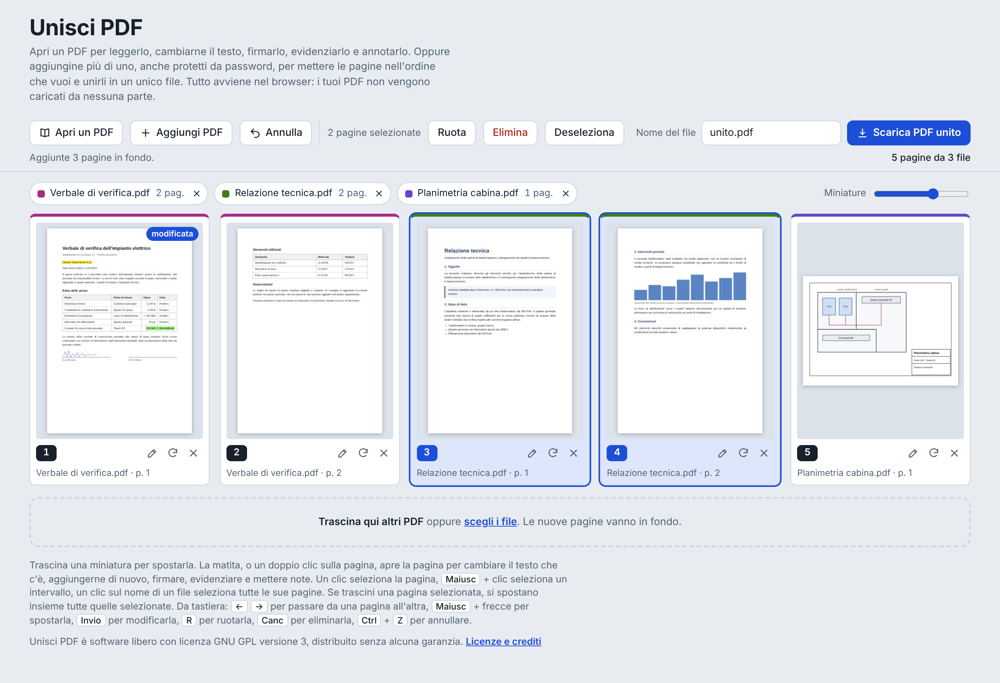

# Unisci PDF

Legge, modifica e unisce i PDF direttamente nel browser: testo, firme, evidenziazioni e note su un documento, oppure riordino, eliminazione e rotazione delle pagine di più documenti da unire in uno. È un solo file HTML che funziona offline e si può anche installare come programma per aprire i PDF.


L'elenco delle pagine, per riordinarle e unire più documenti:



*I documenti negli screenshot sono esempi inventati.*

## Come si usa

I PDF vengono elaborati sul tuo computer: l'app non li invia da nessuna parte e non fa richieste di rete.

### Dal file scaricato

1. Scarica `Unisci_PDF.html`.
2. Aprilo con un doppio clic: si apre nel browser, senza installare niente.
3. Scegli **Apri un PDF** per leggere e modificare un documento, oppure **Aggiungi PDF** per caricarne più di uno e unirli.

### Come programma per aprire i PDF

Serve Edge o Chrome. Una volta installata, l'app si apre con un doppio clic su un PDF e funziona anche senza rete.

1. Apri <https://magnuspub.github.io/Unisci-PDF/> con Edge o Chrome.
2. Installa l'app dal menu del browser (la voce si chiama "Installa" o "App").
3. In Esplora file fai clic con il tasto destro su un PDF, scegli "Apri con", poi "Scegli un'altra app", seleziona Unisci PDF e conferma "Sempre".
4. La prima volta il browser chiede se permettere all'app di aprire i file: conferma.

Aperto così, un PDF si presenta in lettura con gli strumenti a portata di mano. **Salva** riscrive il file che hai aperto, dopo che il browser ti ha chiesto il permesso; **Salva una copia** lascia l'originale com'è.

## Cosa fa

- **Lettura.** Le pagine una sotto l'altra, con zoom e numero di pagina.
- **Modifica del testo esistente.** Clicchi una riga e la riscrivi. Il testo vecchio viene tolto dal file, non coperto, e quello nuovo usa il carattere del documento.
- **Testi e firme.** Aggiungi caselle di testo e la tua firma, disegnata con mouse o dito oppure caricata da una foto.
- **Evidenziatore e fumetti.** Evidenziazioni in più colori e fumetti con una nota che compare al passaggio del mouse. Sono salvati come annotazioni del PDF, quindi restano tali anche negli altri lettori.
- **Unione e ordine.** Carichi più PDF, anche in più riprese, e trascini le miniature per decidere l'ordine. Selezionando più pagine si spostano insieme.
- **Eliminazione e rotazione.** Per la singola pagina, per quelle selezionate o per un file intero. "Annulla" riporta indietro l'ultima modifica.
- **PDF protetti.** Se un PDF richiede la password, l'app la chiede e poi lo tratta come gli altri. Il file salvato non è protetto.

## Limiti

- La modifica del testo cambia la singola riga: il paragrafo non va a capo da solo.
- Un PDF contiene solo le lettere usate nel documento. Se ne scrivi una che manca, quella lettera esce in un carattere simile.
- Le scansioni e il testo dentro blocchi incorporati non sono modificabili.
- La firma è un'immagine, non una firma digitale con certificato.
- Le protezioni diverse dalla password standard dei PDF non sono supportate.
- I moduli PDF non si possono compilare.
- L'apertura con doppio clic funziona solo con l'app installata da Edge o Chrome; Firefox non la prevede.

## Licenza

Unisci PDF è software libero, distribuito con licenza GNU General Public License versione 3 (GPL-3.0): il testo è nel file [`LICENSE`](LICENSE). È distribuito senza alcuna garanzia.

Copyright (C) 2026 magnuspub

## Librerie incluse

`Unisci_PDF.html` contiene al suo interno queste librerie, ciascuna con la propria licenza:

- [@cantoo/pdf-lib](https://github.com/cantoo-scribe/pdf-lib) 2.11.1, licenza MIT
- [PDF.js](https://github.com/mozilla/pdf.js) 3.11.174, licenza Apache-2.0
- [SortableJS](https://github.com/SortableJS/Sortable) 1.15.2, licenza MIT

I testi completi delle licenze e le note di copyright, comprese quelle dei componenti contenuti in pdf-lib, sono in [`THIRD-PARTY-NOTICES.txt`](THIRD-PARTY-NOTICES.txt). Gli stessi testi sono dentro `Unisci_PDF.html` e si leggono dall'app, alla voce "Licenze e crediti" in fondo alla pagina.

## Sorgenti e ricostruzione

- [`src/index.html`](src/index.html) è il sorgente dell'app.
- [`src/build.js`](src/build.js) ci mette dentro le librerie e le licenze e produce `Unisci_PDF.html`, `THIRD-PARTY-NOTICES.txt` e la cartella `docs/`.
- [`docs/`](docs) è l'app come sito installabile, quello pubblicato con GitHub Pages: una copia di `Unisci_PDF.html`, il manifest che permette all'app installata di aprire i PDF e il file che la fa funzionare senza rete.
- [`src/make-icons.py`](src/make-icons.py) disegna le icone in `docs/icons/`.

Per ricostruire i file servono Node.js e npm:

```
npm install
npm run build
```

Le librerie vengono scaricate da npm nelle versioni fissate in `package.json`.
