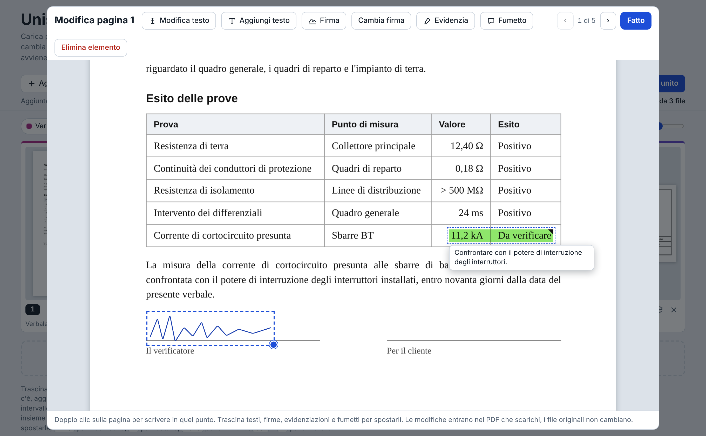

# Unisci PDF

Unisce più PDF in un unico file, direttamente nel browser: riordino, eliminazione e rotazione delle pagine, modifica del testo, firme, evidenziazioni e note. È un solo file HTML che funziona offline.


L'editor di pagina, con un'evidenziazione, la sua nota a comparsa e una firma:



*I documenti negli screenshot sono esempi inventati.*

## Come si usa

1. Scarica `Unisci_PDF.html`.
2. Aprilo con un doppio clic: si apre nel browser, senza installare niente.
3. Aggiungi i PDF con il pulsante oppure trascinandoli sulla pagina.
4. Sistema le pagine e premi **Scarica PDF unito**.

I PDF vengono elaborati sul tuo computer: l'app non li invia da nessuna parte e non fa richieste di rete.

## Cosa fa

- **Unione e ordine.** Carichi più PDF, anche in più riprese, e trascini le miniature per decidere l'ordine. Selezionando più pagine si spostano insieme.
- **Eliminazione e rotazione.** Per la singola pagina, per quelle selezionate o per un file intero. "Annulla" riporta indietro l'ultima modifica.
- **Modifica del testo esistente.** Nell'editor di pagina (la matita sulla miniatura) clicchi una riga e la riscrivi. Il testo vecchio viene tolto dal file, non coperto, e quello nuovo usa il carattere del documento.
- **Testi e firme.** Aggiungi caselle di testo e la tua firma, disegnata con mouse o dito oppure caricata da una foto.
- **Evidenziatore e fumetti.** Evidenziazioni in più colori e fumetti con una nota che compare al passaggio del mouse. Sono salvati come annotazioni del PDF, quindi restano tali anche negli altri lettori.
- **PDF protetti.** Se un PDF richiede la password, l'app la chiede e poi lo tratta come gli altri. Il file unito non è protetto.

## Limiti

- La modifica del testo cambia la singola riga: il paragrafo non va a capo da solo.
- Un PDF contiene solo le lettere usate nel documento. Se ne scrivi una che manca, quella lettera esce in un carattere simile.
- Le scansioni e il testo dentro blocchi incorporati non sono modificabili.
- La firma è un'immagine, non una firma digitale con certificato.
- Le protezioni diverse dalla password standard dei PDF non sono supportate.

## Licenza

Unisci PDF è software libero, distribuito con licenza GNU General Public License versione 3 (GPL-3.0): il testo è nel file [`LICENSE`](LICENSE). È distribuito senza alcuna garanzia.

Copyright (C) 2026 magnuspub

## Librerie incluse

`Unisci_PDF.html` contiene al suo interno queste librerie, ciascuna con la propria licenza:

- [@cantoo/pdf-lib](https://github.com/cantoo-scribe/pdf-lib) 2.11.1, licenza MIT
- [PDF.js](https://github.com/mozilla/pdf.js) 3.11.174, licenza Apache-2.0
- [SortableJS](https://github.com/SortableJS/Sortable) 1.15.2, licenza MIT

I testi completi delle licenze e le note di copyright, comprese quelle dei componenti contenuti in pdf-lib, sono in [`THIRD-PARTY-NOTICES.txt`](THIRD-PARTY-NOTICES.txt). Gli stessi testi sono dentro `Unisci_PDF.html` e si leggono dall'app, alla voce "Licenze e crediti" in fondo alla pagina.

## Sorgenti e ricostruzione

- [`src/index.html`](src/index.html) è il sorgente dell'app.
- [`src/build.js`](src/build.js) ci mette dentro le librerie e le licenze e produce `Unisci_PDF.html` e `THIRD-PARTY-NOTICES.txt`.

Per ricostruire il file servono Node.js e npm:

```
npm install
npm run build
```

Le librerie vengono scaricate da npm nelle versioni fissate in `package.json`.
